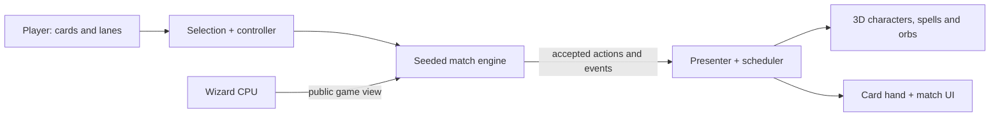

# Cowboys vs. Wizards · Retro Duel

[Play the retro exchange](https://alejandro-publius.github.io/cowboys-vs-wizards-retro/)

Watch the Wizard cast Singularity, pull the Sheriff across the board and take a return shot. The exchange lasts about four seconds and can be restarted or replayed. It is a single fight preview.

To run it locally, run `python3 -m http.server 8000` from the repository root and open [localhost:8000/retro/](http://localhost:8000/retro/). GitHub Pages serves [the retro folder](retro/) as its site root.

The board and character sprites are pixel renders of the original Cowboys vs. Wizards Tripo assets in [assets/models](assets/models). The muted woodland palette, scale and parchment caption draw on [Our Castle](https://github.com/alejandro-publius/our-castle). The 2D timing moves the complete sprites and places the spell, muzzle flash and tracer on the board. The original project's code and history are retained below.

## Original project README

**A haunted-Western card duel where gunslingers, skeletal armies and dragons fight across three 3D lanes.** Choose illustrated cards, sacrifice troops to summon stronger allies, and watch life orbs fall as the Wizard CPU answers.

**[Play now](https://alejandro-publius.github.io/cowboys-vs-wizards/)** · **[Watch the opening (seed 0)](https://alejandro-publius.github.io/cowboys-vs-wizards/?mode=match&deck=starter&seed=0)** · **[Reach the Dragon showdown (seed 60)](https://alejandro-publius.github.io/cowboys-vs-wizards/?mode=match&deck=starter&seed=60)** · **[Judge's 90-second guide](docs/JUDGE-GUIDE.md)**


*The illustrated card game is playable in a browser. The screenshots are captured from the actual game, not generated mockups.* 

## Main menu


Play or resume a match, read the rules, save settings, view earned achievements, or build a 12-card Cowboy deck. Settings and progress stay in this browser. The approved title artwork is still; controls are native keyboard/touch buttons.

## Play

[Play Cowboys vs. Wizards in your browser](https://alejandro-publius.github.io/cowboys-vs-wizards/) · [Seed 0 opening](https://alejandro-publius.github.io/cowboys-vs-wizards/?mode=match&deck=starter&seed=0) · [Seed 60 showdown](https://alejandro-publius.github.io/cowboys-vs-wizards/?mode=match&deck=starter&seed=60)

For a local build, use Node.js 22.18 or later and a WebGL 2 browser. Install dependencies with `npm ci`, then build.

```sh
npm run build
```

Open `dist/cowboys-vs-wizards-board-duel.html`. The single file includes the models, card art and fallback recording. The title menu opens first. Use `?mode=match&deck=starter&seed=0` for the repeatable starter opening with a free Sheriff summon; ordinary matches use the saved deck. A seed reproduces an opening only with the same deck. The seed can also be entered in the game menu. Choose **Attack demo** or append `?mode=demo` for the original Billy and Wizard exchange.

For a static website, run `npm run build -- --web` and serve the entire `dist/web/` directory. It contains an `index.html` and content-hashed assets. Relative URLs allow hosting under a subdirectory.

Follow the tested seed 60 route to the Mounted Billy and Dragon clash. [Seed 60 play-through](docs/morning-handoff.md#the-duel-to-film)

## Verify

| What you need | Command |
| --- | --- |
| Title screen, settings, custom deck and pause/resume in Chrome | `node scripts/browser-menu-check.mjs http://127.0.0.1:PORT/?seed=0` (serve `dist/web/` first) |
| Game, presenter and asset tests | `node scripts/verify-duel.mjs` |
| The same tests by their npm name, as run on every pull request | `npm test` |
| The same tests, a fresh build and an eight-step Chrome replay | `node scripts/verify-duel.mjs --browser` |
| Title menu, match start, WebGL 2 and one summon in WebKit, the Safari engine | `npx -y -p playwright-core@1.64.1 node scripts/browser-webkit-smoke.mjs http://127.0.0.1:PORT/` (serve `dist/web/` first; once: `npx -y playwright-core@1.64.1 install webkit`) |
| Attack demo geometry, grip and event order | `npm run check` |
| Which commit the live site is (after a Pages deploy) | `curl https://alejandro-publius.github.io/cowboys-vs-wizards/build.json`; CI compares it and the live `index.html` digest with the built release ([evidence](docs/evidence/kiro-build-identity.md)) |
| A seeded rules trace | `node scripts/play-match.mjs --seed 60` |

The Chrome check on macOS writes the receipt and screenshots to `.artifacts/kiro/replay/` when invoked through `verify-duel.mjs`. The saved **orb-duel-replay** Workflow runs the same command. See the [Kiro write-up](docs/kiro-brag-sheet.md) for the Spec, hooks, tests, review Power and MCP evidence.

## Architecture at a glance

The rules engine decides which moves are legal and what damage happens; the renderer shows those decisions at the correct moment. This keeps gameplay reproducible while animated attacks can overlap.



[Architecture and source ownership](docs/ARCHITECTURE.md) · [Current verified state and next priorities](docs/PROJECT-STATUS.md) · [Index of all documents](docs/README.md)

## Built with Kiro

Kiro's Requirements-First Orb Duel spec, custom agent, workspace steering, hooks, replay Workflow, and review Power/MCP are part of this repository—not a narrative added after the fact. The Kiro work is distinguished from Fable's match rules/CPU and Codex's integration and verification.

[Follow the judge evidence trail](docs/JUDGE-GUIDE.md) · [Kiro usage and receipts](docs/kiro-brag-sheet.md) · [Actual build log](docs/kiro-build-log.md) · [Active closeout queue](docs/kiro-closeout-queue.md) · [Research/source register](docs/kiro-source-register.md)

For ongoing balance review, the separate [Night Watch Kiro Crew app](https://github.com/alejandro-publius/cowboys-vs-wizards-night-watch) compares committed game revisions on matching CPU seeds, records changes and drafts issue reports. It is an optional local development tool, **not** part of the shipped browser game. [Crew run evidence](docs/evidence/kiro-night-watch.md).

## Code map

| Path | Owns |
| --- | --- |
| `src/game/` | Seeded rules, legal actions, public views and CPU |
| `src/match/` | Selection, controller, scheduler and event playback |
| `src/render/` | Three.js scene, rigs, orbs and combat cues |
| `src/ui/` | Illustrated hand, interactive overlay and menus |
| `src/main.js` | Browser boot, mode switching and frame loop |
| `assets/` | Optimized Tripo models, card illustrations and media |
| `scripts/`, `tests/` | Build, replay, simulation and verification |
| `.kiro/`, `docs/` | Workspace guidance, requirements, research and evidence |

Contributing with an AI agent? Start with [AGENTS.md](AGENTS.md), then use the [task-specific file router](docs/AGENT-ROUTER.md) rather than scanning the whole repository. Work on one owned area in a separate worktree and run its affected check. The engine decides outcomes. The presenter renders the events and their before and after values.

## Assets and attribution

Dragon and Mounted Billy play articulated Blender attack clips. Skeleton uses its fitted Tripo mesh with the duel’s summon, hit and defeat cues. Billy and Wizard use procedural rigs. Sheriff combines the approved sourced Mixamo idle with the existing procedural draw/fire sequence and runtime transition blending. See the [animation plan](docs/character-animation-plan.md) before adding clips or replacing an export.

The build includes Three.js (MIT) and Rapier (Apache-2.0) notices. The pinned Lucca Cerf references and their MIT license are in [docs/references/lucca-character-factory](docs/references/lucca-character-factory). The [build log](docs/kiro-build-log.md) attributes work by Kiro, Fable, Codex, Tripo and the user.

[Watch the 59-second menu and gameplay preview](docs/evidence/gameplay-demo/menu-and-gameplay-preview.mp4) · [Verified closeout deployment](docs/evidence/kiro-closeout-deployment.md)
